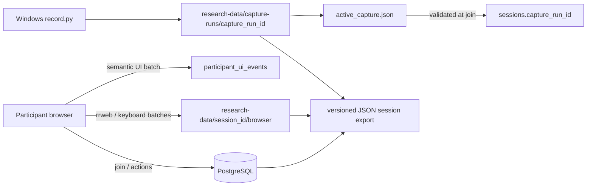
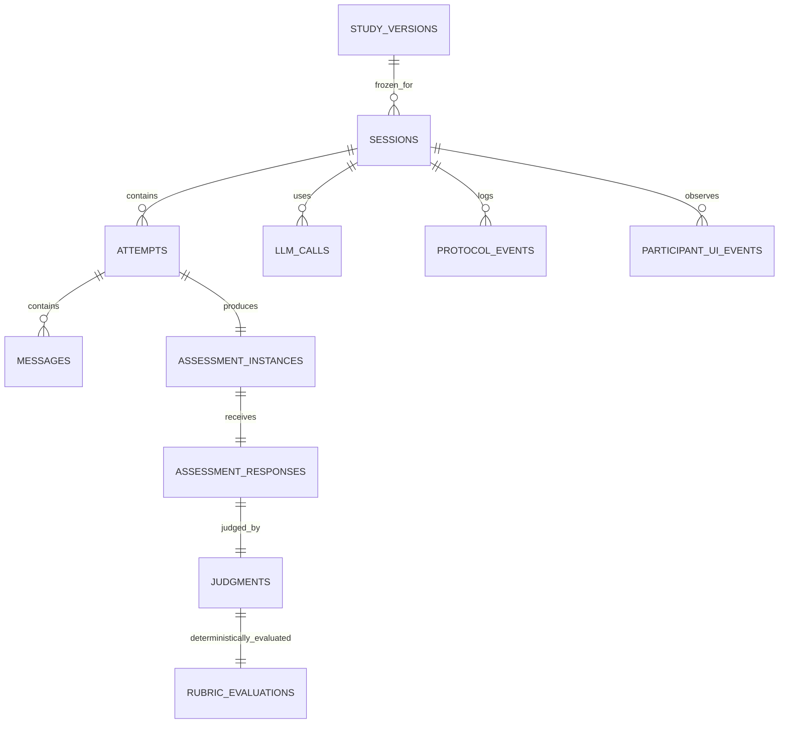

# Complete Study Data-Collection and Storage Specification

**Implementation status:** `CONFIRMED FROM CURRENT CODE` unless a different label appears.  
**Repository / application version:** SOLO-Transition AI Harness `0.0.1`; current checkout `32c0122`.  
**Database migration head:** `0005_capture_run_id` (adds the nullable, unique `sessions.capture_run_id`).  
**Export schema:** `1.1`. **Browser telemetry schema:** `1.0`; keyboard schema `keyboard-1.0`; rrweb library `2.1.7`; capture manifest schema `1.0`.  
**Generated:** 2026-10-19, Asia/Kolkata. This is an implementation audit, not an ethics approval or a claim that every configured collection stream was enabled in a particular deployment.

## 1. Executive summary

The implemented study is `python_fibonacci_memoization`, content version `v0.4`: a four-section individual learning study about recursive Fibonacci and memoization. A participant joins using an institutional ID after acknowledging the join form. The application creates one scientific session, runs C1–C4 in sequence, randomly selects unused pedagogies and unused assessment forms, stores learner/tutor/assessment text and model-operation records in PostgreSQL, and stores optional detailed browser and Windows-capture artifacts on disk.

The primary scientific record is PostgreSQL. The browser record is session-addressed file telemetry plus low-volume PostgreSQL UI events. Windows recording is a host-initiated capture run that may be associated to exactly one session. No video is inserted into PostgreSQL; session exports reference available artifact manifests rather than embedding media.

**Classification:** study text, assessment answers, tutor text, model prompts/responses, rrweb replay, screen capture, and webcam capture are potentially identifiable or sensitive. Institutional ID is stored in the live database; the standard session export omits it and supplies a SHA-256 digest instead. Keyboard telemetry is intentionally coarse and does not store key identity or typed text. A raw capture or rrweb trace can nevertheless contain personal or sensitive visual/textual information and must be governed accordingly.

## 2. Storage architecture and join path



| Store | Path / object | Purpose | Primary join key |
|---|---|---|---|
| PostgreSQL | `sessions` and related tables | authoritative protocol, text, decisions, LLM and UI records | `session_id` UUID |
| Browser artifacts | `research-data/<session_id>/browser/` | rrweb NDJSON, keyboard NDJSON, manifest | `session_id`, `browser_run_id` |
| Windows artifacts | `research-data/capture-runs/<capture_run_id>/` | independent webcam and screen recordings plus evidence | `capture_run_id` |
| Active-marker handoff | `research-data/active_capture.json` | permits participant-session creation only while valid recording runs | `capture_run_id` |
| Export | researcher-selected JSON file | repeatable-read snapshot of session data and artifact manifest index | `session_id`; includes `capture_run_id` |

**Association conditions.** With `REQUIRE_ACTIVE_CAPTURE=true`, join succeeds only if the marker parses, is fresh under `ACTIVE_CAPTURE_MAX_AGE_SECONDS`, points to the expected capture-run directory, its manifest says `RECORDING`, and no session already uses that capture run. The session stores that UUID. With the setting false, no capture run is required or associated. `capture_run_id` is unique but deliberately has no database foreign key because captures are file-system artifacts.

## 3. Study protocol and outcomes

The frozen authored bundle is compiled and persisted as a `study_versions` snapshot. Its protocol defines formal learner states `P` (prestructural), `U` (unistructural), `M` (multistructural), `R` (relational), and `EA` (extended abstract), and transitions C1–C4:

| Transition | Formal movement | Implemented topic / assessment target |
|---|---|---|
| C1 | P → U | Fibonacci’s two-predecessor recurrence, recursive representation, and applicable base cases |
| C2 | U → M | repeated subproblems, recomputation, stored results and lookup/reuse |
| C3 | M → R | causal integration of repeat, cache storage, lookup-before-expansion, and preserved recurrence |
| C4 | R → EA | transfer/invariant reasoning about unfamiliar memoized recursive-Fibonacci implementations |

Each attempt receives an unused pedagogy selected with `secrets.SystemRandom()` from the compiled pedagogies; selection candidates, exclusions, method, selected ID and timestamp are persisted. A fresh, previously unused assessment form is selected per session. Passing is not decided by model output alone: the Judge observation is persisted, then deterministic `RubricEvaluator` rules evaluate gradability, correctness gate, target SOLO state, evidence requirements and blocking misconceptions. Failed attempts use another unused pedagogy until the configured maximum is exhausted. Exhaustion produces scientific outcome `UNRESOLVED`, allows section continuation, and leaves the formal state unchanged. The final session ends `COMPLETED/COMPLETED_EA` only without any unresolved section; otherwise `UNRESOLVED/COMPLETED_WITH_UNRESOLVED_SECTIONS`.

## 4. Time and clock policy

PostgreSQL `DateTime(timezone=True)` fields are written as timezone-aware UTC instants. Application and capture server time use `datetime.now(timezone.utc)`. The standard export converts ordinary datetime values to `Asia/Kolkata` (`+05:30`), while dictionary keys ending `_utc` are deliberately retained as UTC compatibility values. `exported_at` is IST. The participant-facing server view also converts its displayed timestamps to IST.

| Clock | Stored fields / examples | Meaning and limitations |
|---|---|---|
| PostgreSQL server/app UTC | `created_at`, `assigned_at`, `started_at`, `occurred_at`, `server_received_at` | authoritative application receipt/persistence chronology; no NTP audit stored |
| Browser wall clock UTC ms | `client_event_at_utc_ms`, `client_emit_utc_ms` | client-supplied; may be skewed from server or Windows clock |
| Browser monotonic clock | `client_performance_ms`, `performance_time_origin_ms` | useful for within-page sequencing; resets per browser context |
| Capture host UTC + monotonic | capture-event `wall_time_utc`, `monotonic_seconds` | recorder observations and alignment anchors; not a universal synchronized clock |
| Media timeline | ffprobe metadata / FFmpeg progress | independent stream timing; no automatic cross-clock fusion is implemented |

**Derivable but not stored:** elapsed duration can be computed from paired UTC fields (for example `ended_at - started_at`, attempt timestamps, or UI events). There is no single persisted `elapsed_seconds` field, no clock-offset calibration, and no automatic merged media/browser/database timeline.

## 5. Relational schema inventory

All UUID primary keys are PostgreSQL UUID values generated by Python `uuid.uuid4()` unless noted. `JSON` is PostgreSQL JSON; arrays are PostgreSQL arrays. Server defaults are PostgreSQL `now()`.

### 5.1 Study-version tables

| Table | Columns (type; nullable/default; origin) |
|---|---|
| `study_versions` | `id` UUID PK; `study_id` string; `content_version` string; `study_schema_version` string; `content_canonicalization_version` string; `content_hash` varchar(64); `canonical_authored_definition` bytes; `source_bundle` JSON; `source_provenance` JSON; `compiler_contract_version` string; `snapshot_schema_version` string; `snapshot_hash` varchar(64) unique; `compiled_snapshot` JSON; `created_at` timestamptz server-now. All except `created_at` are non-null and come from compilation of authored study files. |
| `active_study_versions` | `study_id` string PK; `study_version_id` UUID FK → `study_versions.id` RESTRICT, non-null; `activated_at` timestamptz server-now; `activated_by` nullable string. Written by study activation, not participant activity. |

`study_versions` also has unique `(study_id, content_version, compiler_contract_version, snapshot_schema_version)`, SHA-256 format checks on both hashes, and index `(study_id, content_hash)`.

### 5.2 Session and attempt tables

| Table | Columns (type; nullable/default; origin) |
|---|---|
| `sessions` | `id` UUID PK; `institutional_id` nullable string unique (join form); `capture_run_id` nullable UUID unique (validated active marker); `study_version_id` UUID FK → study version RESTRICT; `status`, `phase`, `formal_state_id` strings; `current_transition_id` nullable string; `current_attempt_id` nullable UUID FK → attempts RESTRICT; `current_attempt_number` integer default 0; `terminal_reason` nullable string; `lock_version` integer default 0; `last_event_sequence` integer default 0; `application_build_id` string; `runtime_config_snapshot` JSON; `started_at`, `ended_at` nullable timestamptz; `created_at` server-now; `updated_at` server-now/on update. Unless noted nullable, fields are non-null. Runtime creates/updates these as protocol advances. |
| `attempts` | `id` UUID PK; `session_id` UUID FK → sessions RESTRICT; `transition_id`, `pedagogy_id`, `status`, `formal_state_before_id` strings; `sequence_in_transition` integer; `formal_state_after_id`, `completion_reason` nullable strings; `passed` nullable boolean; `outcome_details` nullable JSON; `assigned_at` server-now; `intervention_started_at`, `intervention_completed_at`, `completed_at` nullable timestamptz. Unique `(session_id, transition_id, sequence_in_transition)` and `(session_id, transition_id, pedagogy_id)`. |
| `learner_history_snapshots` | `id` UUID PK; `session_id` UUID FK; `target_attempt_id` UUID FK unique; `transition_id` string; `source_attempt_ids` UUID array; `summary` JSON; `generation_method` string; `llm_call_id` nullable UUID (not FK); `created_at` server-now. It is generated deterministically only for attempts after the first in a transition. |

`started_at` and `intervention_started_at` are not assigned at session creation; they are assigned when the first Tutor operation is reserved by the participant’s Begin action. Thus they represent first intervention start, not join/session-row creation. Subsequent attempts set `intervention_started_at` when their Tutor operation is reserved.

### 5.3 Conversation and assessment tables

| Table | Columns (type; nullable/default; origin) |
|---|---|
| `messages` | `id` UUID PK; `attempt_id` UUID FK; `sequence_no` integer; `role` string; `content_text` text; `content_format` string default `markdown`; `llm_call_id` nullable UUID (not FK); `instructional_trace` nullable JSON; `material_ids`, `exposed_kc_ids`, `exposed_relation_ids` string arrays default empty; `created_at` server-now. Unique `(attempt_id, sequence_no)`. Learner text is plain; tutor text and trace are model-derived. |
| `assessment_instances` | `id` UUID PK; `session_id` UUID FK; `attempt_id` UUID FK unique; `transition_id`, `assessment_family_id`, `assessment_form_id`, `status`, `selection_method` strings; `candidate_form_ids` string array; `selection_audit`, `resolved_component_ids` JSON; `blueprint_snapshot` nullable JSON; `generation_llm_call_id` nullable UUID (not FK); `prompt_snapshot`, `hidden_scoring_context_snapshot` nullable text; `selected_at` server-now; `submitted_at`, `closed_at` nullable timestamptz. Unique `(session_id, assessment_form_id)`. |
| `assessment_responses` | `id` UUID PK; `assessment_instance_id` UUID FK unique; `response_text` text; `response_format` string; `submitted_at` server-now; `client_action_id` UUID unique. All non-null; created on nonblank assessment submission. |

### 5.4 LLM, judgment, and protocol tables

| Table | Columns (type; nullable/default; origin) |
|---|---|
| `llm_calls` | `id` UUID PK; `session_id` UUID FK; `attempt_id`, `assessment_instance_id` nullable UUID FKs; `purpose`, `status` strings; `retry_group_id` UUID; `retry_number` integer; `provider`, `model` strings; `provider_request_id` nullable string; `generation_parameters` JSON; `compiled_prompt_text` nullable text; `request_payload` JSON; `request_body_text` text; `raw_response_text` nullable text; `response_payload`, `parsed_response` nullable JSON; `error_class` nullable string; `error_message` nullable text; `input_tokens`, `output_tokens`, `total_tokens`, `latency_ms` nullable integers; `started_at` server-now; `completed_at` nullable timestamptz. Unique `(retry_group_id, retry_number)`. |
| `judgments` | `id` UUID PK; `assessment_response_id` UUID FK unique; `llm_call_id` UUID FK unique; `rubric_id`, `correctness` strings; `gradable` boolean; `observed_solo_state_id` nullable string; `kc_evidence`, `relation_evidence`, `evidence_summary` JSON; `misconception_ids` string array; `confidence` nullable float; `ambiguity` nullable JSON; `created_at` server-now. |
| `rubric_evaluations` | `id` UUID PK; `judgment_id` UUID FK unique; `attempt_id` UUID FK unique; `transition_id`, `rubric_id`, `formal_state_before_id`, `formal_state_after_id` strings; `rule_snapshot`, `input_evidence_snapshot`, `decision_reasons` JSON; `passed` boolean; `created_at` server-now. This is the deterministic decision record. |
| `protocol_events` | `id` integer autoincrement PK; `session_id` UUID FK; `sequence_no` integer; `event_type` string; `event_version` integer; `attempt_id` nullable UUID (not FK); `actor` string; `correlation_id` UUID; `payload` JSON; `occurred_at` server-now. Unique `(session_id, sequence_no)`. Engine writes actor `SYSTEM` and event version 1. |
| `idempotency_records` | `id` UUID PK; `session_id` UUID FK; `action_type`, `idempotency_key` strings; `request_hash` varchar(64); `result_object_type` nullable string; `result_object_id` nullable UUID; `response_snapshot` nullable JSON; `created_at` server-now; `expires_at` nullable timestamptz. Unique `(session_id, action_type, idempotency_key)`. Standard export deliberately omits `request_hash`. |

### 5.5 Low-volume participant UI table

| Table | Columns (type; nullable/default; origin) |
|---|---|
| `participant_ui_events` | `id` UUID PK; `session_id` UUID FK; `attempt_id`, `assessment_instance_id` nullable UUID FKs resolved server-side; `event_type` string; `client_event_at` timestamptz (from client UTC milliseconds); `client_performance_ms`, `performance_time_origin_ms` floats; `browser_run_id` UUID; `client_sequence` integer; `section_number`, `teaching_activity_number` nullable integers; `surface` string; `payload` JSON default `{}`; `server_received_at` timestamptz. Unique `(session_id, browser_run_id, client_sequence)`. |

## 6. JSON structures and prompt records

The following are structured but content-dependent. Their exact per-study shape is frozen in the `study_versions.compiled_snapshot` and/or generated model output; do not assume a fixed flat schema beyond the listed implementation keys.

| Field | Confirmed current contents |
|---|---|
| `sessions.runtime_config_snapshot` | runtime configuration passed at session creation; current web activation supplies a snapshot through the runtime path. |
| `attempts.outcome_details` | on pedagogy exhaustion, contains `administrative_outcome: PEDAGOGIES_EXHAUSTED_CONTINUE` and `scientific_outcome: UNRESOLVED`; otherwise may be null. |
| `learner_history_snapshots.summary` | `{schema_version, transition_id, target_attempt_id, attempts[]}`; each attempt records source UUID, sequence, pedagogy, completion reason, tutor instructional traces, judged evidence, pass and rubric reasons. |
| `assessment_instances.selection_audit` | eligible candidate form IDs, excluded used IDs, selected ID, selection timestamp. |
| `assessment_instances.resolved_component_ids` | `kc_ids`, `relation_ids`, `evidence_ids`, `misconception_ids`. |
| `llm_calls.request_payload` / `response_payload` | raw provider request/response JSON: `RAW PROVIDER-GENERATED STRUCTURE`; provider-dependent. |
| `llm_calls.parsed_response` | validated structured Tutor, Assessment, or Judge output; its model schema is versioned in the stored prompt envelope. |
| `judgments.kc_evidence` | current runtime stores `demonstrated_evidence_ids`; other Judge evidence resides in parsed response/evidence summary according to model output. |
| `rubric_evaluations.decision_reasons` | JSON array of deterministic reasons, including `RULE_SATISFIED` or named failed gates. |
| `protocol_events.payload` | event-specific payload catalogued below. |
| `participant_ui_events.payload` | client UI metadata under 4 KiB; event-specific and not a source of participant response text by design. |

Prompts are retained in `llm_calls.compiled_prompt_text`, `request_payload`, and `request_body_text`; assessment prompt and hidden scoring context are also copied to `assessment_instances` after generation. The implementation constructs a versioned prompt envelope with schema version `1.0`, prompt-contract version `2.0`, operation/study IDs, content and snapshot hashes, ordered system/user messages, output JSON schema, audit context, canonical prompt text, and prompt hash. Provider raw output and parsed output are retained when available. This provides reproducibility evidence, but provider behavior, model availability, and non-determinism are external limitations.

## 7. Protocol-event catalog

| Event type | When written | Payload |
|---|---|---|
| `SESSION_CREATED` | session persisted | study version UUID; capture run UUID or null |
| `PARTICIPANT_BEGAN_STUDY` | first Tutor operation reserved after Begin | start timestamp |
| `PEDAGOGY_SELECTED` | each attempt | eligible IDs, excluded used IDs, selected ID, method, ISO timestamp |
| `ATTEMPT_CREATED` | each attempt | transition ID, pedagogy ID |
| `INTERVENTION_COMPLETED` | tutor intervention completes | completion reason |
| `ASSESSMENT_SELECTED` | form selected | assessment selection audit |
| `ASSESSMENT_SUBMITTED` | response persisted | assessment UUID |
| `LLM_CALL_STARTED` | call reserved before network work | logical role and call UUID |
| `RUBRIC_EVALUATED` | deterministic rule applied | passed Boolean and reasons |
| `SECTION_COMPLETED` | passed or exhausted transition | transition, scientific outcome, formal-advance flag |
| `SECTION_CONTINUATION_ALLOWED` | pedagogies exhausted | transition, reason, unresolved outcome, current formal state |
| `PARTICIPANT_ADVANCED_SECTION` | explicit next-section action | from/to transition IDs |
| `SESSION_COMPLETED` | explicit final finish | terminal reason and completed/unresolved scientific outcome |

There is no protocol event for a browser render, browser disconnect, typing start, or video-frame observation. Those phenomena belong, where enabled, to UI telemetry, file artifacts, or are not stored.

## 8. Participant UI telemetry

The browser posts batches to `/session/telemetry/ui-events`; the server validates allowed event/surface values, limits a batch to 100, resolves section/attempt/assessment linkage from the frozen protocol and current database state, deduplicates by `(session_id, browser_run_id, client_sequence)`, and stores the table above. Allowed events are:

`SESSION_PAGE_RENDERED`, `SECTION_RENDERED`, `TEACHING_ACTIVITY_RENDERED`, `BEGIN_CLICKED`, `PROCESSING_SHOWN`, `PROCESSING_HIDDEN`, `TUTOR_MESSAGE_RENDERED`, `TUTOR_RESPONSE_SUBMIT_CLICKED`, `ASSESSMENT_RENDERED`, `ASSESSMENT_RESPONSE_SUBMIT_CLICKED`, `ASSESSMENT_COMPLETED_MARKER_RENDERED`, `GENERATION_ERROR_RENDERED`, `RETRY_CLICKED`, `SECTION_COMPLETE_RENDERED`, `COMPLETED_SECTION_REVIEW_OPENED`, `NEXT_CLICKED`, `FINISH_CLICKED`, `STUDY_COMPLETE_RENDERED`.

Allowed surfaces are `session`, `section`, `teaching`, `processing`, `assessment`, `error`, `section_complete`, `study_complete`, and `review`. Render events are emitted after relevant DOM insertion in `requestAnimationFrame`; they are not evidence of actual eye-visible perception. A UI row proves client emission and server receipt, not attention, comprehension, or successful long-term browser delivery.

## 9. rrweb browser replay artifacts

Each session-page load generates a `browser_run_id`. Browser artifact layout is:

```text
research-data/<session_id>/browser/manifest.json
research-data/<session_id>/browser/rrweb/<browser_run_id>.ndjson
research-data/<session_id>/browser/rrweb/.batches/<browser_run_id>/<batch_id>.json
research-data/<session_id>/browser/keyboard/<browser_run_id>.ndjson
research-data/<session_id>/browser/keyboard/.batches/<browser_run_id>/<batch_id>.json
```

An rrweb NDJSON line is a wrapper containing original `rrweb_event` plus `telemetry_schema_version`, `browser_run_id`, monotonically increasing `sequence`, `client_emit_utc_ms`, `client_performance_ms`, server-added `batch_id`, and `server_received_at_utc`. Batches allow at most 500 events and each serialized event at most 256,000 bytes. Batch-marker files contain `event_count` and server receipt UTC and make retransmission idempotent. `manifest.json` contains `schema_version`, `artifact_type: browser_telemetry`, and `runs[]` metadata created by the web endpoint.

The recorder configuration uses local vendored rrweb only, `maskAllInputs: true`, `maskTextSelector: '.message.learner'`, `sampling.input: 'all'`, `recordCanvas: false`, and `recordCrossOriginIframes: false`. These settings reduce plain-text persistence of input and learner bubbles in replay, but rrweb is still a dense client-side DOM/event artifact. It must not be treated as anonymous or as a complete recording if uploads fail.

## 10. Keyboard-dynamics artifacts

Keyboard capture attaches only to `#learner-text` and `#assessment-response`, using native `keydown` and `keyup`. It does not attach to the join institutional-ID control, use document-wide hooks, OS hooks, clipboard capture, or third-party telemetry.

Each keyboard NDJSON wrapper has exactly these client fields, plus server-added `batch_id` and `server_received_at_utc`:

`telemetry_schema_version`, `browser_run_id`, `client_sequence`, `event_type`, `press_id`, `client_event_at_utc_ms`, `client_performance_ms`, `performance_time_origin_ms`, `section_number`, `teaching_activity_number`, `surface`, `key_class`, `flags`.

`event_type` is `KEYDOWN` or `KEYUP`; surface is `TUTOR_RESPONSE` or `ASSESSMENT_RESPONSE`; class is one of `CHAR`, `DIGIT`, `SPACE`, `ENTER`, `BACKSPACE`, `DELETE`, `TAB`, `ARROW`, `MODIFIER`, `PUNCTUATION`, `OTHER`. `flags` contains exactly Boolean `repeat`, `is_composing`, `ctrl`, `alt`, `shift`, `meta`. A local `event.code` map creates press pairing but is never serialized. The server rejects raw `key`, `code`, and `value` fields. Thus raw characters, field text/value, selection, caret, clipboard, and a key-up lacking observed key-down are **NOT STORED** in keyboard artifacts.

## 11. Windows recording and capture manifest

`tools/windows_capture/record.py` is host-operated, independent of the web process. It resolves a project-local pinned FFmpeg/FFprobe runtime (`tools/windows_capture/runtime`), requires its configured pinned build string, discovers DirectShow video sources, requires exactly one camera unless `--no-webcam`, probes modes, and selects the highest reported resolution at at least 15 FPS (then highest FPS). Screen capture uses `gdigrab` desktop at default 30 FPS. Default encoding is `libx264`, preset `medium`, CRF 18, MKV. The app neither starts nor stops recording.

```text
research-data/active_capture.json                         [only while recording]
research-data/capture-runs/<capture_run_id>/capture_manifest.json
research-data/capture-runs/<capture_run_id>/capture_manifest.sha256
research-data/capture-runs/<capture_run_id>/webcam/webcam.mkv
research-data/capture-runs/<capture_run_id>/webcam/{capture_events.ndjson,ffmpeg_stderr.log,ffmpeg_stderr_timestamped.ndjson,ffprobe.json}
research-data/capture-runs/<capture_run_id>/screen/screen.mkv
research-data/capture-runs/<capture_run_id>/screen/{capture_events.ndjson,ffmpeg_stderr.log,ffmpeg_stderr_timestamped.ndjson,ffprobe.json}
```

The capture manifest records status, run UUID, tool version, host OS, FFmpeg/FFprobe versions, configuration (camera identity/mode, screen backend/FPS, codec settings, policy and readiness probe outputs), and per-stream command/status/events/progress anchors/stderr paths/media file size/SHA-256/ffprobe result. `capture_manifest.sha256` hashes the completed manifest. `ffprobe.json` is FFprobe’s `-show_format -show_streams -of json` output; exact stream keys are `RAW PROVIDER-GENERATED STRUCTURE` and depend on the produced media and installed build.

Each stream’s `capture_events.ndjson` records `LAUNCH_REQUESTED`, `PROCESS_STARTED`, `FIRST_PROGRESS_OBSERVED`, later `PROGRESS_OBSERVED`, `STOP_REQUESTED`, `PROCESS_EXITED`, and when media exists `FFPROBE_STARTED`, `FFPROBE_COMPLETED`, `HASH_STARTED`, `HASH_COMPLETED`. Entries include wall UTC and recorder monotonic timestamp from `stamp()`, with appropriate command, PID, raw progress, return code or SHA-256 details. Timestamped FFmpeg stderr lines have the same recorder timestamp fields plus `line`.

## 12. Identifiers, uniqueness, and idempotency

| Identifier | Scope / source | Constraint / use |
|---|---|---|
| `session_id` | UUID generated at session creation | central database and browser-artifact key |
| `institutional_id` | participant join form, normalized by web layer | unique in live `sessions`; export replaces it with SHA-256 |
| `capture_run_id` | UUID generated by `record.py` | unique nullable session association; active-marker and capture directory key |
| `study_version_id` | compiler-generated UUID | frozen content snapshot FK |
| `attempt_id`, `assessment_instance_id`, `assessment_response_id`, `llm_call_id`, `judgment_id` | UUID PKs | relational linkage described above |
| `browser_run_id` | browser-generated UUID | separates reload/browser contexts and UI-event uniqueness |
| `batch_id` | browser-generated UUID | idempotent rrweb/keyboard batch marker |
| `client_action_id` | form-generated UUID | unique assessment response submission identity |
| idempotency key | client action form field | unique per session/action; request hash detects conflicting reuse |
| protocol sequence | incrementing `last_event_sequence` | unique ordered event ledger per session |

## 13. Export behavior

`build_session_export()` uses a repeatable-read database transaction, serializes all current columns for the session’s study version, attempts, history snapshots, messages, assessment instances/responses, LLM calls, judgments, rubric evaluations, participant UI events, protocol events and idempotency records, then calculates `data_sha256` over canonical JSON. It does not modify the session. It does not export `institutional_id` or idempotency `request_hash`; it supplies `institutional_id_sha256` and otherwise retains complete table columns. The artifact index reports only manifest relative paths, type/schema/status and SHA-256 if readable; video/NDJSON bytes are never embedded.

## 14. Privacy, exclusions, and quality limitations

**Not collected by this implementation:** demographics, name/email (unless entered into screen/webcam artifacts outside app controls), IP address fields, geolocation, mouse telemetry as a semantic table, clipboard, raw keyboard identity, OS-level keylogging, background audio, automated face/voice/emotion analysis, screen video in PostgreSQL, or an automatically generated cross-modal timeline.

**Important limitations:** client telemetry is best effort; browser crash/offline navigation can leave gaps. RRweb and keyboard batch transport is separately idempotent but not transactionally coupled to PostgreSQL. Capture start/stop is independent from browser join and can include material before/after participant engagement. Capture validation confirms marker/manifest state, not actual camera framing or participant consent. Provider payloads are retained but provider-side logging, model drift, and network behavior are not controlled here. No per-stream dropped-frame metric, OS time-sync evidence, media-frame-to-browser offset, or explicit participant withdrawal workflow is implemented in current code.

## 15. Analysis-ready reconstruction guidance

1. Start with `sessions`, `protocol_events` ordered by `sequence_no`, then attempts, assessments, responses, judgments and rubric evaluations. These determine scientific outcomes.
2. Use `participant_ui_events` ordered by `server_received_at` and then client time/sequence for interface chronology; preserve both clocks rather than silently choosing one.
3. Use browser `manifest.json` to enumerate rrweb and keyboard runs. Deduplicate is already enforced by marker files, but retain missing-file and manifest-readability status.
4. Resolve `sessions.capture_run_id` to capture manifest. Use each stream’s progress anchors and ffprobe output; do not assume webcam and screen start simultaneously or exactly align with browser time.
5. Record all transformations, time-zone conversions, content redactions, and exclusion rules in a derivative analysis manifest. These derivatives are **NOT STORED** by the application.

## 16. Completeness audit: persistent write paths

| Write subsystem | Persistent destination | Covered sections |
|---|---|---|
| Study compiler/activation | `study_versions`, `active_study_versions` | 3, 5.1, 6 |
| Session runtime | sessions, attempts, history, assessments, responses, judgments, rubric decisions, protocol events | 3, 5.2–5.4, 7 |
| AI execution | LLM calls, learner/tutor messages, generated assessment snapshots | 5.3–5.4, 6 |
| Web idempotency | `idempotency_records` | 5.4, 12, 13 |
| UI telemetry endpoint | `participant_ui_events` | 5.5, 8 |
| rrweb endpoint | browser manifest, rrweb NDJSON, batch markers | 9 |
| Keyboard endpoint | keyboard NDJSON, batch markers, manifest updates | 10 |
| Windows capture tool | active marker, capture manifest/hash, media, probe/log/event files | 2, 11 |
| Session export | researcher-selected JSON output | 4, 13 |

## 17. Ambiguities and implementation findings

| Finding | Status / consequence |
|---|---|
| Session and intervention start columns exist but current runtime does not assign them. | `CONFIRMED FROM CURRENT CODE`; calculate timing from other anchors or treat unknown. |
| `LearnerHistorySnapshot.llm_call_id`, `Message.llm_call_id`, `AssessmentInstance.generation_llm_call_id`, and `ProtocolEvent.attempt_id` are UUIDs without declared foreign keys. | Referential meaning is application-level; validate joins defensively. |
| `capture_run_id` is an external file artifact with no FK. | File retention/moves can break association even when DB value remains. |
| Capture `preflight` prints `active_capture: none`; it does not inspect an existing active marker. | It is device/runtime readiness, not collection-state verification. |
| Current active-capture association only occurs when deployment enables it. | A session with null `capture_run_id` is valid when capture is not required. |
| No automatic reconciliation job is present for stale active markers, incomplete capture manifests, or orphan artifact directories. | Researchers must audit file/DB consistency before analysis. |
| Exact provider payload and ffprobe JSON keys are not stable application contracts. | Treat as raw provider-generated data and preserve originals. |

## Appendix A. Current file map

```text
src/solo_harness/db/models.py                 PostgreSQL model declarations
src/solo_harness/runtime/engine.py            deterministic protocol runtime
src/solo_harness/runtime/ai.py                prompt compilation, model operations and persistence
src/solo_harness/web.py                       join, actions, telemetry endpoints, capture association
src/solo_harness/telemetry.py                 browser artifact validation/writing
src/solo_harness/research_export.py           read-only session export
src/solo_harness/research_time.py             IST researcher representation
src/solo_harness/static/telemetry/*.js        browser rrweb/UI/keyboard emitters
tools/windows_capture/record.py               host recording runtime
studies/python_fibonacci_memoization/v0.1/    authored study bundle
migrations/versions/0001...0005              schema history
```

## Appendix B. Data-classification matrix

| Data | Location | Classification / handling note |
|---|---|---|
| Institutional identifier | live `sessions.institutional_id` | direct identifier; exclude from routine export sharing |
| Learner responses / tutor conversation | messages, assessment responses, prompts, rrweb/screen | potentially identifying free text |
| Model provider request/response | `llm_calls` | may reproduce participant text and hidden study material |
| UI/keyboard timing | DB/NDJSON | behavioral data; pseudonymous only when join mapping is protected |
| Screen/webcam media | capture-run filesystem | highly sensitive audiovisual/visual environment data |
| Study definitions/rubrics | study version and authored files | research material; may reveal assessment keys |

## Appendix C. Concrete database relationships



## Appendix D. Terms

- **Formal state:** deterministic persisted learner state P/U/M/R/EA.
- **Attempt:** one pedagogy intervention plus its fresh assessment and judgment for a transition.
- **Scientific outcome:** passed/unresolved conclusion for a transition, distinct from the ability to continue administratively.
- **Browser run:** one client page context; may change on reload.
- **Capture run:** one host recorder invocation, independently managed from the application.
- **Raw provider-generated structure:** opaque JSON supplied by an LLM provider or FFprobe, retained without an application-level fixed schema.

## Appendix E. Field-origin legend

- **Server generated:** database/app clock, UUID, runtime transition, compiler, or recorder.
- **Client supplied:** browser telemetry timestamps/sequences/payloads, form text, action identifiers.
- **Provider generated:** model raw and parsed response/payload, token and request IDs where supplied.
- **Derived but not stored:** durations, clock alignment, analytics and merged timelines.

## Appendix F. Retention/deletion

Retention duration, backup/encryption access policy, participant withdrawal/deletion handling, and a canonical de-identification procedure are **NOT DETERMINED FROM CURRENT IMPLEMENTATION**. They require study-governance decisions outside this codebase.

## Appendix G. Collection lifecycle (implemented sequence)

```mermaid
sequenceDiagram
  participant Windows recorder->>filesystem: preflight; record creates capture-run and active marker
  participant Browser->>application: acknowledge + institutional ID
  application->>filesystem: validate active marker/manifest when required
  application->>PostgreSQL: create session, first attempt, protocol events
  participant Browser->>application: Begin / Tutor / assessment actions
  application->>PostgreSQL: text, LLM call, assessment, judgment, rubric and events
  participant Browser->>filesystem: rrweb and keyboard batch artifacts
  participant Windows recorder->>filesystem: stop, probe, hash, complete manifest
  analyst->>PostgreSQL: repeatable-read export
  analyst->>filesystem: resolve artifact manifests by session/capture IDs
```

## Appendix H. UI event semantics

| Category | Event names | Interpretation boundary |
|---|---|---|
| Page/section | `SESSION_PAGE_RENDERED`, `SECTION_RENDERED`, `STUDY_COMPLETE_RENDERED` | DOM render callback, not visual attention |
| Teaching | `TEACHING_ACTIVITY_RENDERED`, `TUTOR_MESSAGE_RENDERED`, `TUTOR_RESPONSE_SUBMIT_CLICKED` | activity/message render or click |
| Processing/error | `PROCESSING_SHOWN`, `PROCESSING_HIDDEN`, `GENERATION_ERROR_RENDERED`, `RETRY_CLICKED` | client DOM/click state, not network truth by itself |
| Assessment | `ASSESSMENT_RENDERED`, `ASSESSMENT_RESPONSE_SUBMIT_CLICKED`, `ASSESSMENT_COMPLETED_MARKER_RENDERED` | render/click state; database submission is separate evidence |
| Navigation | `BEGIN_CLICKED`, `SECTION_COMPLETE_RENDERED`, `COMPLETED_SECTION_REVIEW_OPENED`, `NEXT_CLICKED`, `FINISH_CLICKED` | participant click or rendered completion state |

## Appendix I. Timing-field index

| Field / path | Time source | Stored timezone / export representation |
|---|---|---|
| all DB `*_at` datetimes | server/app or client conversion | UTC in DB; IST in export unless key ends `_utc` |
| `ProtocolEvent.occurred_at` | DB server default | UTC / IST export |
| `ParticipantUIEvent.client_event_at` | browser Date.now | UTC / IST export |
| `ParticipantUIEvent.server_received_at` | app UTC | UTC / IST export |
| browser wrapper `client_emit_utc_ms` | browser Date.now | raw UTC milliseconds retained |
| browser wrapper `server_received_at_utc` | app UTC | raw UTC ISO retained |
| capture marker `started_at_utc` | recorder host UTC | raw UTC ISO retained |
| capture events | recorder `stamp()` | raw UTC + monotonic seconds retained |
| FFmpeg progress | FFmpeg | raw progress fields, not normalized by app |

## Appendix J. Recorder readiness and failure boundaries

`preflight` checks pinned runtime version, chosen camera mode when webcam enabled, `gdigrab` availability, and short camera/screen null-output probes. It does not begin a scientific session and does not validate a database connection, active study, join page, camera framing, human consent, disk capacity, NTP synchronization, or a pre-existing active capture. `record` writes a `RECORDING` manifest before starting streams, emits the active marker only after both streams remain alive for 0.5 seconds, and removes the marker during normal cleanup. It suppresses `OSError` when sending FFmpeg `q` on shutdown, then waits or kills after 15 seconds. A crash/power loss can still leave incomplete artifacts or a stale marker.

## Appendix K. Export omissions and transformations

| Item | Export treatment |
|---|---|
| `sessions.institutional_id` | omitted; `institutional_id_sha256` added (SHA-256 of value, or null) |
| `idempotency_records.request_hash` | omitted |
| Other mapped table columns | serialized as rows, UUIDs as strings, bytes decoded UTF-8 |
| Database datetimes | IST ISO 8601 except JSON keys ending `_utc` |
| Artifact media / NDJSON | not copied; manifest index only |
| Export output file | written atomically through `.tmp`, refuses overwrite unless requested |

## Appendix L. Researcher pre-analysis checklist

1. Confirm export’s migration/build/version fields against the deployment used.
2. Verify every non-null `capture_run_id` has a readable, completed capture manifest and expected files/hashes.
3. Preserve original timezone values and document all IST conversions.
4. Check protocol sequence continuity and relational references, especially application-level UUID links without FK constraints.
5. Identify missing browser runs/NDJSON before interpreting absence as participant behavior.
6. Restrict access to IDs, free text, model payloads, rrweb and audiovisual recordings.

## Appendix M. Requirements coverage map

This document addresses the requested architecture, IDs, schema, study transitions, randomization, learner/tutor/assessment/Judge/LLM records, timing, rrweb, keyboard, Windows capture, export, privacy, limitations, file map, data-classification, ER and lifecycle diagrams, and persistent-write completeness audit. Items not guaranteed by current implementation are explicitly marked **NOT STORED**, **DERIVABLE BUT NOT STORED**, **RAW PROVIDER-GENERATED STRUCTURE**, or **NOT DETERMINED FROM CURRENT IMPLEMENTATION** rather than inferred.
